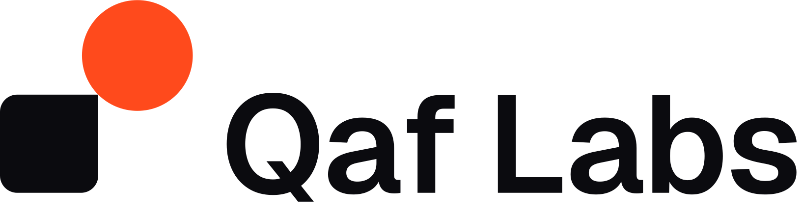
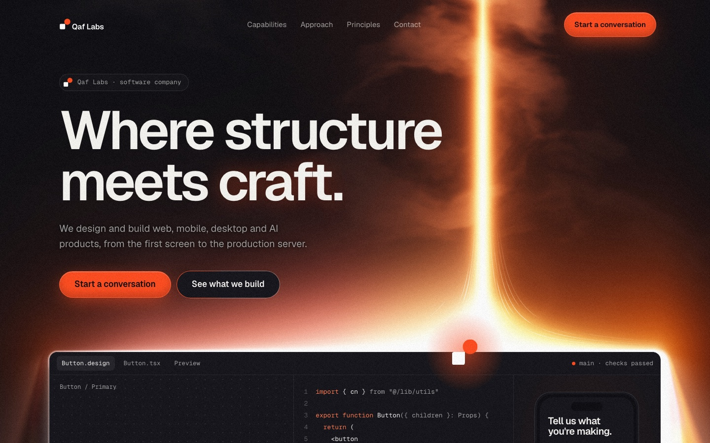
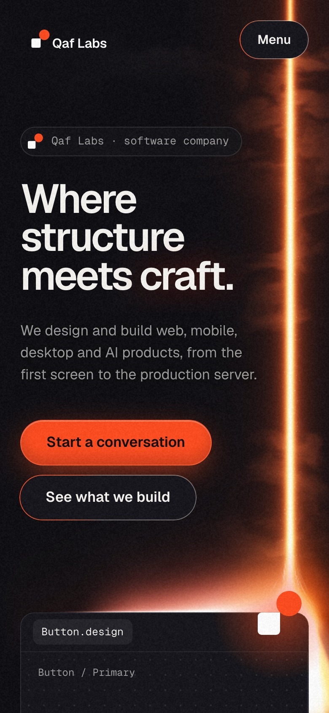

<p align="center">
  <a href="https://qaflabs.net">
    <picture>
      <source media="(prefers-color-scheme: dark)" srcset="public/brand/svg/qaf-labs-logo-on-dark.svg">
      <source media="(prefers-color-scheme: light)" srcset="public/brand/svg/qaf-labs-logo.svg">
      
    </picture>
  </a>
</p>

<p align="center">
  <strong>Where structure meets craft.</strong><br>
  The website of Qaf Labs, a software company that designs and builds web, mobile, desktop and AI products.
</p>

<p align="center">
  <a href="https://qaflabs.net">qaflabs.net</a>
  &nbsp;·&nbsp;
  <a href="mailto:hello@qaflabs.net">hello@qaflabs.net</a>
</p>

<br>

<p align="center">
  
</p>

## What's on the page

One page, read top to bottom:

1. **Hero.** A single beam of vermilion light lands on a frame that shows one button three ways: in the design canvas, as code, and on a phone.
2. **Capability band.** The kinds of work we take on, moving as you scroll.
3. **Capabilities.** Web apps, mobile, AI products, desktop, e-commerce, and engineering and infrastructure, each with a small illustration of the work.
4. **Manifesto.** The one light section.
5. **Approach.** Discover, Design, Engineer, Ship, Evolve. The square and the circle of the mark move closer with each step and meet on the last one.
6. **Principles and Stack.** How we hold the work, and the languages and tools we use.
7. **Contact.** Start a conversation, or copy the email address.

<p align="center">
  
</p>

## Built with

| | |
| --- | --- |
| Framework | Next.js 16 (App Router, Cache Components, React Compiler, Turbopack), React 19 |
| Language | TypeScript, strict |
| Styling | Tailwind CSS 4, Geist and Geist Mono |
| Components | React Bits, Magic UI, Aceternity UI and Spectrum UI, installed with the shadcn CLI and edited to the brand |
| Motion | Motion, GSAP and Lenis, plus one WebGL effect for the hero light |
| Tests | Playwright and axe |
| Package manager | Bun |

## Run it

```bash
bun install
bun run dev     # http://localhost:3000
```

```bash
bun run build
bun run start
bun run lint
```

## Test it

The Playwright suite runs against a production build at 1440 x 900 and 390 x 844. It checks every section and control, keyboard use, axe, reduced motion, 200% zoom, tap targets, and that only the brand colours appear on the page.

```bash
bunx playwright install chromium   # once
bun run test
```

Measured with Lighthouse on a local production build (median of three runs):

| | Performance | Accessibility | Best Practices | SEO |
| --- | --- | --- | --- | --- |
| Desktop | 100 | 100 | 100 | 100 |
| Mobile | 94 | 100 | 100 | 100 |

## Where things are

| Path | What it holds |
| --- | --- |
| `src/app/` | Root layout, metadata, global CSS with the brand tokens, and the page that puts the sections together. |
| `src/components/sections/` | One file per section, rendered on the server. |
| `src/components/brand/` | Client pieces tuned to the brand: the hero light, headline, frame, capability cards, Approach panel, orbit and Copy email. |
| `src/components/ui/`, `src/components/spectrumui/`, `src/components/*.tsx` | Installed library components. Each edited file opens with a comment listing its brand edits. |
| `src/content/home.ts` | All page copy. |
| `src/config/site.ts` | Contact email and navigation. |
| `tests/e2e/` | Playwright tests. |
| `public/brand/` | The logo kit. Read `public/brand/README.md` before using the logo. |
| `docs/design/landing/` | The approved design: a runnable reference page, screenshots of every section, and the spec. |
| `docs/adr/` | Decisions a reader might not expect, such as brand rules taking priority over the spec. |
| `GLOSSARY.md` | Names for the brand and page parts. |

## The brand in short

- **Three colours.** Ink `#0B0B0F`, paper `#F6F5F1` and vermilion `#FF4A1C`, plus their transparencies.
- **The mark is fixed.** Use the logo files as they are. The square and the circle always touch at one point, and they are never redrawn, recoloured, rotated or separated.
- **Only true claims.** No client logos, testimonials or statistics until real ones exist.

## Open items

- Approve the copy marked `TODO copy` in `src/content/home.ts`.
- Confirm that `hello@qaflabs.net` is a live inbox.
- Bring mobile LCP from about 3.1s down to the 2.5s target.
